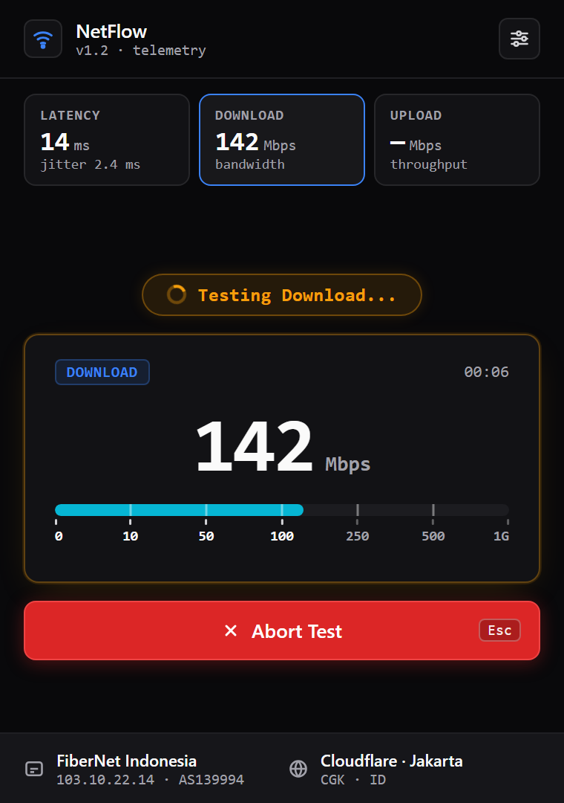
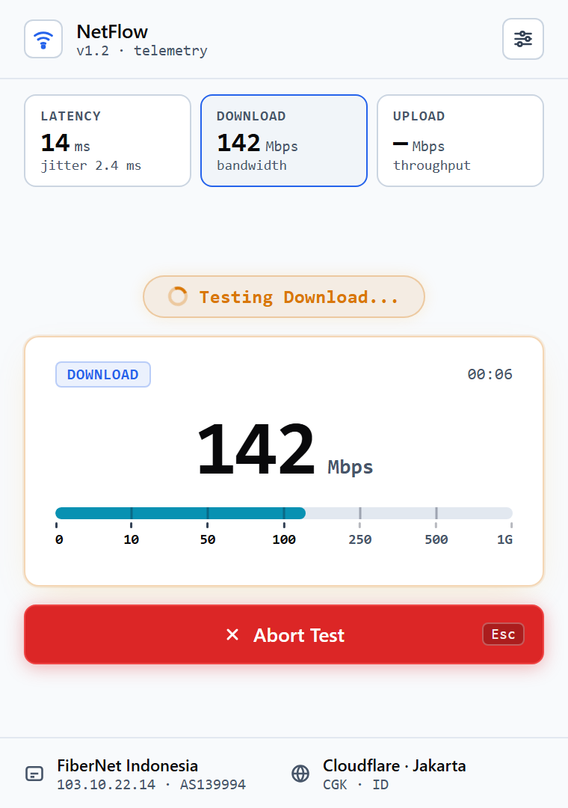

# Netflow WiFi Speedtest Extension

**NetFlow** is a fast, lightweight browser extension that lets you check your WiFi and internet speed right from your toolbar—no extra tabs, ads, or clutter.

  
  &nbsp;&nbsp;
  

## What It Does

- **One-Click Speed Test**: Measure your **Download**, **Upload**, **Latency (Ping)**, and **Jitter** in seconds.
- **Instant Quality Rating**: Automatically summarizes your connection quality (*Excellent*, *Fast*, *Good*, *Fair*, or *Slow*) once the test finishes.
- **Network Details**: Shows your detected ISP, public IP address, and nearest test server location.
- **Clean & Customizable**: Switch between **Dark**, **Light**, or **Auto (System)** themes, and optionally enable **Auto-start** so a test runs as soon as you open the popup.
- **Keyboard Shortcuts**: Press `Space` to start or re-run a test, and `Esc` to cancel anytime.

## How to Install

1. Download or clone this repository to your computer.
2. Open `chrome://extensions` in Chrome (or any Chromium-based browser like Edge or Brave).
3. Turn on **Developer mode** in the top-right corner.
4. Click **Load unpacked** and choose the downloaded folder.
5. Pin **NetFlow** to your toolbar and click its icon to start testing.

## Under the Hood (Technical Notes)

For those curious about how it works:

- **Engine**: Uses Cloudflare's global edge network (`speed.cloudflare.com`) for low-latency, multi-stream download/upload testing with TCP warmup exclusion and trimmed-percentile averaging.
- **Stack**: Built with Chrome **Manifest V3** and plain HTML, CSS, and vanilla JavaScript—zero external dependencies.
- **Permissions**: Only requests `storage` (to save your theme and auto-start preference locally) and access to `https://speed.cloudflare.com/*` to run the speed test.
